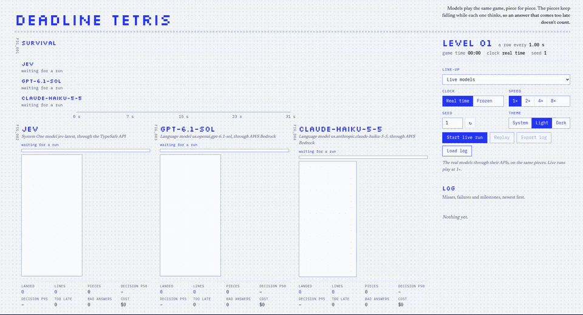

# Deadline Tetris

Deadline Tetris puts decision models side by side in the same Tetris game, piece
for piece. In the main mode the pieces keep falling while each model thinks, so
**an answer that arrives after the piece has landed doesn't count**. The point
is to compare a System One model (Jev, from TypeSafe) with regular language
models fairly. Both get identical games, identical prompts and identical rules,
and the game can be played under time pressure or without it.

It is our own take on the Jev vs Haiku vs Opus Tetris video. That video showed
only the real-time race. This version also separates **speed** from **placement
skill**, includes **baselines**, and saves every run so it can be replayed and checked.

---

## Demo

[](docs/media/demo.mp4)

*A full live run (seed 1, real-time clock) at 4× speed: Jev vs gpt-6.1-sol vs
claude-haiku-5-5, both through AWS Bedrock. Click for the full two-minute
recording at normal speed ([demo.mp4](docs/media/demo.mp4)).*

---

## Results so far

**Who wins a run:** the board with the most **pieces landed**, meaning pieces
the model put where it chose, in time. Ties go to more lines, then longer
survival. (In the optional [40-line sprint](#two-goals-survive-or-sprint) the
first to 40 lines wins instead.) Every board in a run gets the same pieces,
prompts and rules. Runs stopped within the first few decisions are left out.
Regenerate any of these numbers with `bun run stats`.

Every run reports two things: **speed** (pieces landed, too late) and
**move quality** ([best moves](#move-quality-best-moves): how often a model picked
the reference heuristic's top option, graded on every answer, late or not).

### Round 2 (2026-10-10): Jev vs GPT-6.1 Sol vs Claude Haiku 5.5

**Jev** (`jev-latest`, TypeSafe API) against **gpt-6.1-sol** and
**claude-haiku-5-5**, both on AWS Bedrock through the regional `us.` inference
profiles. 5 real-time runs: four on seed 1 and one on seed 2; one played to the end and four were stopped early.
(`bun run stats --since 2026-10-10T18:40 --min-decisions 20`)

| Model | Runs | Wins | Pieces landed | Landed per run | Lines | Lines per 100 landed | Too late |
|---|---|---|---|---|---|---|---|
| **Jev** | 5 | **5** | **368** | 73.6 | 92 | 25.0 | **0 (0%)** |
| claude-haiku-5-5 | 5 | 0 | 154 | 30.8 | 39 | 25.3 | 4 (3%) |
| gpt-6.1-sol | 5 | 0 | 46 | 9.2 | 10 | 21.7 | 17 (27%) |

| Model | Decisions | Median | p90 | p95 | Fastest | Slowest | Answered in time | Tokens out per decision |
|---|---|---|---|---|---|---|---|---|
| **Jev** | 369 | **279 ms** | 318 ms | 330 ms | 251 ms | 626 ms | **100%** | 241 |
| claude-haiku-5-5 | 157 | 1.52 s | 1.60 s | 1.63 s | 1.35 s | 2.87 s | 98% | 35 |
| gpt-6.1-sol | 55 | 4.01 s | 9.27 s | 15.35 s | 1.70 s | 19.04 s | 84% | 113 |

**Move quality** (every answer that named an option, including the late ones):

| Model | Graded answers | Best moves | In top 3 | Median answer time |
|---|---|---|---|---|
| **gpt-6.1-sol** | 55 | **75%** | **96%** | 4.01 s |
| Jev | 372 | 57% | 82% | 279 ms |
| claude-haiku-5-5 | 157 | 51% | 82% | 1.52 s |

**The run that played to the end** (seed 1, 112 s, the one in the demo):

| Model | Pieces landed | Lines | Too late | Topped out | Level reached | Cost | Cost per 1,000 decisions |
|---|---|---|---|---|---|---|---|
| **Jev** (winner) | **115** | **30** | 0 | at 88 s | 6 | $0.0081 | **$0.07** |
| claude-haiku-5-5 | 53 | 12 | 4 | at 112 s (lasted longest) | 8 | $0.0151 | $0.27 |
| gpt-6.1-sol | 12 | 2 | 11 | at 93 s | 7 | $0.0745 | $3.92 |

**What it shows**
- **Speed:** Jev answers in about 0.28 s and never missed a deadline. Haiku
  is remarkably steady at about 1.5 s (95th percentile 1.63 s) and missed 3% of
  pieces. GPT-6.1 Sol has a median of 4 s but a long tail (95th percentile 15 s),
  so 27% of its pieces fell before it answered.
- **Wins:** Jev won all five runs on pieces landed, placing about 2.4× as many
  pieces as Haiku and 8× as many as GPT.
- **GPT-6.1 Sol plays the best moves, it just can't keep up.** Its answers
  match the reference heuristic's top pick 75% of the time (Jev 57%, Haiku
  51%), and 96% of them are in the top three. Its low score in real time comes
  from answer time, not from the prompt or from bad choices. The frozen clock
  measures quality with speed taken out; GPT hasn't had a frozen run yet.
- **Placement:** Jev and Haiku place equally well, at about 25 lines per 100
  pieces landed. GPT manages about 22. None comes near the ~40 needed to keep
  the stack from rising. Because Jev plays fastest, its stack rises fastest:
  in the full run it topped out first (88 s), while Haiku lasted longest (112 s).
- **Cost:** per 1,000 decisions, Jev $0.07, Haiku $0.27, GPT $3.92, about 56× Jev.
- **Caveats:** mostly one seed, and only one run went to the end. GPT's price
  comes from third-party Bedrock listings, not AWS's own price list. Prices
  were added partway through, so the first two runs show $0 for GPT and Haiku,
  and the cost columns above come from the full run only.

### Round 1 (2026-10-09): Jev vs dev-model-alpha

**Jev** against **dev-model-alpha** (OpenAI-compatible gateway), seed 1.
(`bun run stats --since 2026-10-09T16:20 --min-decisions 20`)

| Model | Clock | Runs | Wins | Pieces landed | Landed per run | Lines | Too late |
|---|---|---|---|---|---|---|---|
| **Jev** | real time | 5 | **5** | **523** | 104.6 | 133 | **0** |
| dev-model-alpha | real time | 5 | 0 | 16 | 3.2 | 0 | 24 |
| **Jev** | frozen | 1 | **1** | 20 | 20.0 | 3 | 0 |
| dev-model-alpha | frozen | 1 | 0 | 1 | 1.0 | 0 | 0 |

| Model | Decisions | Median | p90 | p95 | Fastest | Slowest | Answered in time | Tokens out per decision |
|---|---|---|---|---|---|---|---|---|
| **Jev** | 523 | **294 ms** | 338 ms | 361 ms | 257 ms | 626 ms | **100%** | 241 |
| dev-model-alpha | 29 | 10.5 s | 27.2 s | 31.8 s | 1.8 s | 36.8 s | 55% | 2,394 |

- dev-model-alpha reasons at length, about 2,400 output tokens for a one-line
  answer, so 60% of its pieces fell before it answered, even at the slowest levels.
- In the one run that played to the end, both boards topped out at about the
  same time (84 s and 83 s) for opposite reasons. Jev landed 113 pieces and
  buried itself; dev-model-alpha landed 3, and 11 more fell before its answer arrived.
- No prices were set for dev-model-alpha, so its cost shows as $0. The only
  frozen run lasted 10 s.

---

## Contents

1. [Quick start](#quick-start)
2. [Models and configuration](#models-and-configuration)
3. [How a run works](#how-a-run-works)
4. [What the models are asked](#what-the-models-are-asked)
5. [How each answer is judged](#how-each-answer-is-judged)
6. [Reading the screen](#reading-the-screen)
7. [Running Laya (self-hosted)](#running-laya-self-hosted)
8. [Live, mock and replay](#live-mock-and-replay)
9. [Server API and run logs](#server-api-and-run-logs)
10. [Project layout](#project-layout)
11. [Testing and tools](#testing-and-tools)
12. [Known limitations](#known-limitations)

---

## Quick start

Requires [Bun](https://bun.sh) 1.4 or later. There is no separate frontend build: one Bun process serves the
page and the API.

```sh
bun install
cp .env.example .env   # add the keys for the models you want (see below)
bun dev                # http://localhost:5317
```

When the server starts it prints the line-up and whether each model is ready:

```
Deadline Tetris on http://localhost:5317/
  Line-up  live-jev, bedrock-gpt, bedrock-opus
  Jev                ready
  Laya               off (Set LAYA_BASE_URL in .env)
  gpt-6.1-sol        ready
```

Open the page, press the **Models** button in the top bar, tick up to six models
for the line-up (press **Test** on any of them to send one real move), and press
**Start live run**. No keys yet? The **Line-up** menu has mock line-ups that run
entirely in the browser.

---

## Models and configuration

Every model on a board goes through one of three **adapters**, chosen by the API it speaks:

| Adapter | API | For | Offered in the page |
|---|---|---|---|
| **Completion** | OpenAI-compatible Chat Completions, `POST {baseUrl}/chat/completions` | chat models: OpenAI, OpenRouter, Groq, Together, vLLM, Ollama, Gemini's OpenAI endpoint, gateways | yes |
| **Decision** | the Decisions API, `POST {baseUrl}/v1/systemone` | models that score options: Jev, Laya, Cloudflare Clef, AWS Strands Decider | yes |
| **Bedrock** | AWS Bedrock's Converse API (signed AWS requests) | chat models on Bedrock | no; `models.json` only |

Models come from two files:

- **`models.json`** (committed): the built-in models. Keys and addresses are
  `${ENV_VAR}` placeholders filled from `.env`, so the file holds no secrets. A
  model whose variables aren't set shows as unavailable, with the reason.
- **`models.local.json`** (git-ignored, mode 600): models added in the page,
  with their keys, and the line-up you picked. It is plain JSON and can be
  edited by hand.

**Adding a model in the page:** **Models** → **Add model**, pick Completion or
Decision, and give a name, the API address, the model name and a key. **More
settings** has prices (for the cost column), a timeout, a full request address
(for APIs with an unusual path, like Cloudflare's), extra request fields, and
per-adapter options. Saving runs one test move straight away.

The full reference (every setting, both wire formats, how to write a new
adapter) is in **[docs/models.md](docs/models.md)**.

### Built-in models

| Id | Model | Adapter | Needs in `.env` |
|---|---|---|---|
| `live-jev` | Jev (`jev-latest`), TypeSafe | Decision | `TYPESAFE_API_KEY` |
| `live-clef` | Cloudflare Clef, Workers AI | Decision | `CLOUDFLARE_ACCOUNT_ID`, `CLOUDFLARE_API_TOKEN` |
| `live-laya` | Laya `typed-decisions`, self-hosted ([Running Laya](#running-laya-self-hosted)) | Decision | `LAYA_BASE_URL` (`LAYA_API_KEY` if set on the server) |
| `live-strands` | AWS Strands Decider 2B, self-hosted (`strands-decider serve`) | Decision | `STRANDS_BASE_URL` |
| `live-llm` | any OpenAI-compatible chat model | Completion | `LLM_MODEL`, `LLM_API_KEY` (`LLM_BASE_URL`, `LLM_LABEL` optional) |
| `bedrock-gpt` | GPT-6.1 Sol | Bedrock | AWS credentials |
| `bedrock-opus` | Claude Opus 5.5 | Bedrock | AWS credentials |
| `bedrock-haiku` | Claude Haiku 5.5 | Bedrock | AWS credentials |

Mock sources (simulated in the browser, no API calls) can also be in a line-up:
`jev`, `llm-fast`, `llm-frontier`, `llm-flaky`, `heuristic`, `random`, `no-input`.

### Other settings (`.env`)

| Setting | What it does | Default |
|---|---|---|
| `PORT` | Port for the page and API | `5317` |
| `LINEUP` | The line-up until one is picked in the page, as model ids, left to right. Up to 6. | `live-jev,live-llm` |
| `AWS_REGION`, `AWS_ACCESS_KEY_ID`, `AWS_SECRET_ACCESS_KEY`, `AWS_SESSION_TOKEN` (or `AWS_PROFILE`) | Credentials for the Bedrock adapter. Temporary session credentials expire and must be refreshed. | `us-east-1` |
| `MODELS_FILE`, `LOCAL_MODELS_FILE` | Where the two model files are | `models.json`, `models.local.json` |
| `RUNS_DIR` | Where live runs are saved | `runs` |

**Keys stay on the server.** The page only learns each model's name, settings
without the key, and whether it can run. `.env` is read once at startup:
**restart `bun dev` after editing it.**

Prices in `models.json` (USD per million tokens, regional `us.` inference profiles for Bedrock):

| Model | Input | Output | Cache read | Cache write | Source |
|---|---|---|---|---|---|
| Jev (`jev-latest`) | 0.042 | 0 | — | — | TypeSafe |
| Cloudflare Clef | 0.24 | 0 | — | — | Workers AI pricing (`clef-flash`: 0.09) |
| gpt-6.1-sol | 2.20 | 11.00 | 0.11 | 2.75 | third-party Bedrock listings (OpenAI's $2 / $10 plus Bedrock's 10% regional premium) |
| claude-haiku-5-5 | 0.11 | 0.55 | 0.011 | 0.1375 | AWS Price List API |
| claude-opus-5-5 | 4.40 | 22.00 | 0.22 | 5.50 | AWS Price List API (cache write: the listed global $5.00 plus the 10% regional premium) |

---

## How a run works

### Same game for everyone
- A run has a **seed**. The seed fixes the piece sequence, using the standard
  "7-bag" randomizer (every 7 pieces contain each shape once). **Every board gets
  the same pieces in the same order.**
- The same seed and settings give the same game. With mock models the whole run
  is reproducible. With live models the pieces repeat, but the models' answers can vary.
- One game proves little. For real conclusions, run several seeds (e.g. 1–10) and compare averages.

### The two clocks

| | **Real time** | **Frozen** |
|---|---|---|
| While a model thinks | gravity keeps pulling the piece down | the game waits |
| Answer counts if… | it arrives before the piece locks | it arrives within 30 s |
| What it measures | **is the model fast enough for a live loop?** | **does the model place pieces well?** |
| Speed control | live: 1× only; mock and replay: 1–8× | same |

Run both on the same seed. Real time shows speed, and frozen shows skill without speed.

### Two goals: survive or sprint

The **Goal** setting picks what a run is about. It's recorded in the run's
config, so replays and `bun run stats` use the same rules.

| | **Survive** (default) | **40 lines** (sprint) |
|---|---|---|
| A board stops when | it tops out (or places 1,000 pieces) | it tops out, or **clears 40 lines** (shown as FINISHED) |
| Winner, real time | most pieces landed, then lines, then time survived | **first to 40 lines**; boards that fell short rank by lines, then pieces landed |
| Winner, frozen clock | same as real time | **fewest pieces to 40 lines**, since time there mostly measures waiting |

The rules live in one place, `src/arena/ranking.ts`, shared by the results
chart and the stats script.

### Rules and timings (defaults in `src/arena/types.ts`, `DEFAULT_CONFIG`)

| Rule | Value | Notes |
|---|---|---|
| Board | 10 × 20, plus 2 hidden rows above | pieces appear in the top visible row |
| Gravity | `(0.8 − (level−1)·0.007)^(level−1)` seconds per row | the standard Tetris speed curve: 1 s/row at level 1, under 1 ms/row by level 20 |
| Levels | +1 every **15 s** of game time, up to 20 | time-based, not line-based, so the deadline shrinks for everyone at the same pace |
| Lock delay | **500 ms** | a resting piece locks after this long |
| Entry delay | **200 ms** | pause between a lock and the next piece |
| Drop after a decision | **30 ms per row**, never slower than gravity | see below |
| Frozen-clock timeout | **30 s** per piece | |
| End of run | every board out, **1,000 pieces** placed (counts as *survived*), or **10 minutes** | |

### What happens to a piece
1. The piece appears and **the request goes out to the model straight away**,
   with a list of every landing spot (next section).
2. **If the answer arrives in time**, the piece turns and slides over the chosen
   spot at its current height, then **falls into place at the drop speed** and
   locks when it lands. The fall is part of the game, not a screen effect, so
   live runs, replays and logs all show it, and it's identical for every board.
3. **If the piece locks first** (real time), it lands wherever gravity took it,
   in its spawn rotation and column. That counts as **too late**.
4. **If the answer is invalid or the request fails**: in real time the piece
   keeps falling and lands wherever gravity takes it. On the frozen clock it
   falls straight down from where it is, as it also does when no answer arrives within 30 s.

Once a piece has locked, the next one appears after the entry delay. The model
still gets a fresh request for every piece, even if earlier answers are still in
flight.

---

## What the models are asked

### 1. Listing the legal landing spots (`candidates()` in `src/engine/game.ts`)
When a piece appears, the engine starts from the spawn position and:

1. tries **all 4 rotations** in place, skipping any that would overlap something (no "wall kicks");
2. **slides** each rotation left and right one column at a time until it hits a wall or a block;
3. **drops** it straight down from each reachable column to find where it lands;
4. **removes duplicates**: S, Z, I and O look the same in some rotations, so one option is kept per distinct set of final cells;
5. sorts by column, then rotation, and numbers them **`option_1 … option_N`**.

That gives about 9 options for O, 17 for S, Z and I, and up to 34 for T, J and L.

**"Legal" here means** every spot you can reach by turning at the top, sliding
sideways and dropping straight down. Tucking a piece under an overhang and
T-spins aren't included. This is the usual simplification in Tetris AI
benchmarks, and it gives every model the same fixed menu to choose from.

### 2. Describing each option (`src/arena/prompt.ts`)
For every option the engine places the piece on a copy of the board and
measures the result. Both models receive **the same text, word for word**:

```
Instructions: You are playing Tetris. Choose where the current piece should land.
Good placements clear lines, avoid creating holes, and keep the stack low and flat.

Board, 10 columns by 20 rows, top row first ("#" filled, "." empty):
..........          (12 empty rows omitted here)
...####...
..#.####..
.###.###..
##...##...
#....##...
#....#....

Current piece: S
Next pieces: T, I, J
Level: 3

option_1: Rotation 1, columns 1-2, lands 5 rows above the floor; clears no lines, creates 2 holes; stack height after: 7, bumpiness after: 9.
option_2: Rotation 0, columns 1-3, lands 5 rows above the floor; clears no lines, creates 1 hole; stack height after: 6, bumpiness after: 7.
…
```

- **Lines cleared**: full rows this placement would complete.
- **Holes created**: new empty cells with a block somewhere above them (negative means it uncovers some).
- **Stack height after**: height of the tallest column.
- **Bumpiness after**: total height difference between neighbouring columns (lower is flatter).

**Why the options come with these numbers (on purpose).** Jev is a System One
model. It doesn't plan or work through board geometry step by step: it reads a
state and a set of predefined options, and returns a probability for each one.
So this arena asks the question that kind of model is built for: *given clear
descriptions of every legal move, how quickly and how well can you pick one?*
The engine does the geometry, and the model does the choosing. The language
model gets exactly the same descriptions, so neither side has more information.
For that reason there is deliberately no "board only" variant, where options
would carry just a rotation and columns: it would test spatial reasoning, which
is not the comparison this project is about.

### 3. Sending it

| | Decision adapter (`server/adapters/decision.ts`) | Completion adapter (`server/adapters/completion.ts`) |
|---|---|---|
| Request | `POST {baseUrl}/v1/systemone` | `POST {baseUrl}/chat/completions` |
| Board text | the `state` field | the user message |
| Options | a `choice` question with one entry per option (`option_N` → description) | listed as `option_N: description` lines after the board |
| Answer | `choice`, a probability for every option, and a `confidence` | strict JSON `{"choice":"option_N"}`; the schema only allows the offered ids |

Every decision model gets byte-for-byte the same question. Two kinds of
per-model setting change how it is sent, never what it says:

- **Extra request fields.** Laya's default token budget for the option list is
  192–256 tokens and the full list is about 1,100, so its entry in `models.json`
  raises `max_len` and `head_max_len`. If a request still doesn't fit, the
  server says so and the Test button shows it.
- **Option-order rotations.** Some decision models prefer options listed early
  ([Laya documents this](https://github.com/NandhaKishorM/laya#option-order)).
  With `rotations: N` the same question is asked N times in one request, each
  copy with the options shifted (`option_order`), and the probabilities are
  averaged. The model must accept `option_order`: laya-serve does; Cloudflare
  Clef rejects it; Strands Decider ignores it.

**AWS Bedrock models** (`server/adapters/bedrock.ts`) get the same system and
user text as the completion adapter. They go through Bedrock's Converse API,
which uses one request shape for every provider, and answer with a forced
`choose_placement` tool call whose `choice` is limited to the offered ids.
Bedrock caches OpenAI prompts automatically and reports cache reads and writes
separately, so those are counted as input tokens to keep the token columns comparable.

**Latency** is measured on the server's clock, from just before the request to
just after the response is read, so it **includes the network round trip**, as
a real game loop would experience it.

---

## How each answer is judged

The game checks every answer against its own list of options. Nothing is
guessed from free text.

| Status | Meaning | Where it shows |
|---|---|---|
| **ok** | arrived in time and named a valid option; the piece goes there | "decided in X" |
| **too late** | the piece locked before any answer arrived | *Too late* stat, "no answer in X, piece dropped" |
| **late** | the answer for an already-locked piece finally arrived (it tells you how late) | Log |
| **invalid** | not valid JSON, or not one of the offered ids | *Bad answers*, Log |
| **error** | HTTP error, timeout or network failure | *Bad answers*, Log |
| **blocked** | only in the optional `movement: "path"` mode: the chosen spot couldn't be reached from where the piece had fallen | *Bad answers*, Log |
| **timeout** | frozen clock only: no answer within 30 s | Log |

**Cost** = tokens × the per-million prices from `.env`. The providers report the token counts.

### Move quality (best moves)

Speed alone can't tell a slow model with good judgement from a bad one, so every
answer is also graded. When a piece appears, the game scores every offered
option with the **reference heuristic**. That's the classic hand-written
Dellacherie evaluator, the same one the mock players use, in
`src/engine/heuristic.ts`. Options that tie share a rank. The answer's rank is
stored on its `decision` event as `bestRank` (1 = the heuristic's top pick).

- **Best moves** = share of graded answers with rank 1. **In top 3** (stats only) = rank 3 or better.
- **Late answers are graded too**, against the piece they were asked about. This measures judgement apart from speed.
- Invalid answers, errors and timeouts aren't graded.
- The heuristic is a yardstick, not the truth. It looks at one piece and ignores the next ones, so a model planning ahead can lose a point here for a move that's actually better. Treat a gap of a few points as noise.
- `bun run stats` grades older logs (from before `bestRank` existed) the same way, from the logged board and options.

---

## Reading the screen

The page has three screens, and each fits one window without scrolling.

**Setup and fight** share one layout:
- **Top bar.** Before a run it holds the settings: Line-up (the live models, or
  a mock line-up), Clock (Real time or Frozen), Goal (Survive or 40 lines) and
  Seed (the dice picks a random one). Then come icon buttons for Results,
  Replay, Export log, Load log, **Models** (pick the line-up, test and add
  models) and Theme, and **Start**. During a run the bar shows the level, how
  fast pieces fall, game time, clock, goal and seed, plus Pause and Stop. Space
  pauses or resumes a mock run or replay. Adding `?speed=4` to the address
  fast-forwards mock runs and replays.
- **Standings strip**: one slot per model, sliding into rank order as the run goes.
- **Boards**, in up to two rows of three. Each card has:
  - **The board**. In the gutter are the next 3 pieces, plus labels with arrows pointing at:
    - **solid outline + "OPT N, xx% chosen"**: where the model put the last piece;
    - **dashed outlines + "OPT N, xx%"**: the two strongest alternatives the model considered.
  - **Deadline bar**: time spent thinking against the time left before the piece locks. Hatched means the deadline passed.
  - **Stats**:
    - **Landed X of Y**: pieces placed where the model chose, in time, out of all that locked.
    - **Lines.**
    - **Best moves**: see [move quality](#move-quality-best-moves).
    - **Decision p50 / p95**: median and 95th-percentile answer time.
    - **Too late**, **Bad answers** and **Cost**.

**Results** appears when a run ends. Its header names the winner by the run's
win rule. Below it:
- the game replayed as a race;
- pieces landed (or lines) over game time;
- **smart versus fast**: best moves against time per decision;
- time per decision (median and p95);
- a table with every number.

**Are the outlines real?**
- **Live Jev**: yes. The chosen spot is Jev's `choice`, and the dashed outlines and percentages are Jev's own probabilities from the API (top 2 alternatives at 1% or more).
- **Live language model**: the chosen spot is real. There are **no dashed alternatives**, because a chat model returns only a choice, without probabilities.
- **Mock models**: simulated. A pretend model picks randomly, weighted toward the hand-written bot's favourite spots.
- **The option list itself is always real**: OPT numbers are the `option_N` ids both models were sent.

---

## Running Laya (self-hosted)

[Laya](https://github.com/NandhaKishorM/laya) (ConvAI Innovations, Apache 2.0)
is an open-weight System One model: a 421M-parameter ModernBERT encoder that
answers typed questions in one forward pass, like Jev. Its repository ships
`laya-serve`, an HTTP server with the same `/v1/systemone` API as TypeSafe.

**On this machine (CPU, Docker):**

```sh
git clone https://github.com/NandhaKishorM/laya && cd laya
LAYA_MODELS=typed-decisions LAYA_PRELOAD=1 LAYA_THREADS=8 \
  docker compose -f compose.yaml -f compose.http.yaml up --build laya-serve
curl -s localhost:8000/health
```

**On a GPU** (e.g. an AWS `g4dn.xlarge` with a T4, the card Laya's own
benchmarks use), add `-f compose.cuda.yaml` before `up`. Without Docker:
`pip install "laya[serve]"` and run `laya-serve`, with the same environment variables.

Then in `.env`:

```
LAYA_BASE_URL=http://localhost:8000
LAYA_HOST_NOTE=self-hosted, CPU
```

Restart `bun dev`, then tick Laya in the Models panel and press **Test**.

**A short-lived GPU box on AWS:** `deploy/ec2/launch.sh` starts a `g5.xlarge`
(NVIDIA A10G, about $1 an hour) that serves Laya on port 8000 and
[AWS Strands Decider 2B](https://github.com/strands-labs/strands-decider) on port 8001,
each installed from a pinned version into its own virtualenv. It opens the ports to
your IP only, writes `LAYA_*` and `STRANDS_*` into `.env`, and deletes itself after
one hour (pass other minutes as the first argument; `WITH_LAYA=0` serves Strands only).
Then `deploy/ec2/wait-ready.sh` waits until both answer real moves, warming them up
first (Strands compiles its GPU kernels on the first request, which takes longer than
the arena's timeout), and reports setup errors from the box's boot log as they appear.
Restart `bun dev` afterwards so the page uses the new address. `deploy/ec2/teardown.sh`
removes the box sooner, and cleans up after one that already deleted itself.
For debugging, the box has a throwaway SSH key: `ssh -i .ec2-key.pem ubuntu@$EC2_IP`.
Strands Decider needs an Ampere or newer GPU (bf16 and Triton kernels); for Laya alone,
`INSTANCE_TYPE=g4dn.xlarge` (T4) is half the price. Strands Decider's server has no
authentication, so the firewall rule is what protects it.

Things to know before reading its numbers:
- **Hardware is part of its latency.** Jev runs on TypeSafe's servers, Laya on
  whatever you give it. On a CPU, expect hundreds of milliseconds or more per
  decision; on a T4-class GPU, tens. Say which in `LAYA_HOST_NOTE`, so it's on the board.
- **The question is bigger than Laya is tuned for.** Its docs suggest fewer than
  20 options per choice, and the `typed-decisions` checkpoint was trained on
  1,024-token inputs from four business workflows (customer service, invoices,
  security incidents, agent traces). A Tetris piece has up to 34 options and the
  request is about 1,600 tokens. Laya gets the same options as everyone else;
  changing the game for one model would break the comparison.
- **Without rotations it mostly picks the first options.** In four six-model
  runs on 2026-10-12 (seed 1, T4, no rotations) Laya chose option 1 or 2 in 56% of
  its moves (Jev: 18%), stacked the left wall and topped out after 16 pieces every
  time. That matches the position bias its README measures, which is why its
  entry uses `rotations: 4`.

---

## Live, mock and replay

| | Live | Mock | Replay |
|---|---|---|---|
| Where it runs | on the server (it holds the keys) | in the browser | in the browser |
| Models | real APIs | simulated profiles | whatever the log recorded |
| Speed | **1× only** | 1–8× | 1–8× |
| Pause | no | yes (Space) | yes (Space) |
| Saved to `runs/` | yes, automatically | no; use **Export log** | — |

**Why live runs can't be fast-forwarded:** a real API call takes as long as it
takes. At 8×, Jev's 0.3 s of real waiting would count as 2.4 s of game time and
make it unfairly late. To watch a live run faster, let it finish, then press
**Replay**, or **Load log** with a file from `runs/`, and pick 2–8×. Replays
redraw the recorded events; nothing is re-decided.

**Mock profiles** (`src/mock/profiles.ts`) imitate kinds of models:

| Id | Behaves like | Typical decision time |
|---|---|---|
| `jev` | System One model, returns probabilities | ~0.28 s |
| `llm-fast` | small chat model | ~0.75 s |
| `llm-frontier` | large reasoning model, better picks | ~6 s |
| `llm-flaky` | chat model with bad answers, errors and hangs | ~1.2 s |
| `heuristic` | hand-written evaluator (Pierre Dellacherie's), always its best spot | ~3 ms |
| `random` | any legal spot | ~1 ms |
| `no-input` | never answers | — |

With the default rules the mocks reproduce the video. The `llm-fast` mock tops
out around level 13 with about 9 late pieces, and the `llm-frontier` mock around level 5–7.

---

## Server API and run logs

**Statistics:** `bun run stats` reads every log in `runs/` and prints per-run
and per-model tables: wins, pieces landed, lines, too-late rate, best moves and
top-3 share, sprint results (target reached, time and pieces to it), answer-time
percentiles, in-time/late/invalid/error counts, deadline margin, tokens, cost
and Jev's confidence. Options: `--since <UTC time>`, `--min-decisions <n>`,
`--json <file>`, or a list of log files. Stopped and cut-off runs are handled.

| Method | Path | Purpose |
|---|---|---|
| GET | `/api/sources` | every source with its name, kind, and whether it's available (never keys) |
| GET | `/api/models` | every configured model: settings without the key, `hasKey`, availability |
| POST | `/api/models` | add a model (body: its settings); 400 with the field name if one is wrong |
| PUT / DELETE | `/api/models/:id` | change or remove a model added in the page (built-in ones live in `models.json`) |
| POST | `/api/models/:id/test` | one real decision (first piece of seed 1): status, choice, latency, tokens |
| GET / PUT | `/api/lineup` | the live line-up, `{ "sources": [...] }`; PUT saves it to `models.local.json` |
| POST | `/api/runs` | start a live run (body: run config); returns its id |
| GET | `/api/runs` | saved runs, newest first |
| GET | `/api/runs/:id/events` | server-sent event stream; catches up from the start, then goes live; resumes after a reconnect |
| GET | `/api/runs/:id/log` | the saved run as JSONL |
| POST | `/api/runs/:id/stop` | stop a run |

**Run logs** are saved to `runs/<timestamp>-seed<N>.jsonl`, one event per line.
The page's **Export log** produces the same format, so any log can be loaded and replayed.

| Event | When |
|---|---|
| `run_started` | first line; includes the full config |
| `level` | each level change, with the new gravity |
| `spawn` | a piece appears, with its legal options and its deadline |
| `move` | the piece moved (gravity or the drop after a decision) |
| `decision` | an answer arrived: status, choice, probabilities, latency, tokens, cost, and `bestRank` (the choice's rank by the reference heuristic) |
| `lock` | a piece locked: its cells, rows cleared, and the board after |
| `topout` / `survived` / `goal` | a board finished (`goal`: reached the sprint's line target) |
| `run_finished` | last line: `all_out`, `time_limit` or `stopped` |

---

## Project layout

```
models.json             built-in models (committed; keys as ${ENV} placeholders)
server/                 Bun server: page + API, live runs
  index.ts              routes
  config.ts             reads .env (port, files, default line-up)
  runs.ts               live runs on the wall clock, SSE, saving logs
  sources.ts            every source a board can use: configured models and mocks
  sample.ts             one test decision outside a run (Test button, smoke script)
  adapters/             one file per wire format: completion.ts, decision.ts, bedrock.ts;
                        shared.ts (timing, errors, prices, the chat prompt), types.ts (the Adapter interface)
  models/               the model list: types.ts, validate.ts, env.ts (${ENV} placeholders), store.ts
  routes/models.ts      /api/models and /api/lineup
src/engine/             game rules: pieces, board, gravity, landing spots, the hand-written evaluator
src/arena/              the shared core
  simulation.ts         one run: clock, levels, deadlines, decisions, drops, events, grading
  ranking.ts            who wins: the survival and sprint rules
  prompt.ts             the text every model receives
  types.ts              config, events, decision sources, DEFAULT_CONFIG
  serverBackend.ts      browser ↔ server (live runs)
  replayBackend.ts      replays and JSONL import/export
src/mock/               mock profiles and the in-browser mock backend
src/ui/                 React + canvas UI, theme, store; ModelsPanel.tsx and ModelForm.tsx
deploy/ec2/             a short-lived GPU box serving Laya and Strands Decider
scripts/                stats.ts, smoke.ts, fake-providers.ts, Playwright helpers (*.mjs)
docs/                   models.md (adapters and model settings), media/ (demo recording)
runs/                   saved live runs (git-ignored)
```

---

## Testing and tools

```sh
bun test                    # engine, simulation, adapters, model store and API tests
CALIBRATE=1 bun test        # also print how each mock profile fares
bun run typecheck
bun run stats               # statistics from saved runs (see "Results so far")
bun run smoke               # one real decision from every model that can run
bun run smoke live-laya -n 5   # chosen models, five times each, with the median round trip
bun run fake-providers      # stand-in Decisions and Chat Completions APIs on :5400
```

**Rehearsing without keys or cost:** start `bun run fake-providers`, then in the
page's Models panel add a Decision model at `http://localhost:5400` and a
Completion model at `http://localhost:5400/v1` (any model name and key).

Playwright screenshot helpers live in `scripts/*.mjs`. Run them while `bun dev`
is up, with `CHROME_PATH=/usr/bin/google-chrome bun scripts/live.mjs <out-dir>`.

---

## Known limitations

- **"Lands N rows above the floor" is off by one.** A piece resting on the floor reads as "1 row above the floor".
- **No advanced moves.** Wall kicks, tucks under overhangs and T-spins aren't in the option list.
- **Dashed outlines after a line clear** are drawn at their pre-clear height, so they can appear to float.
- **Laya runs on hardware you choose.** Its latency reflects that machine, not just the model.
- **Live latency includes your network.** Running from a different region changes the numbers.
- **One seed is one game.** Compare across several seeds before drawing conclusions.
- **Speed and survival are linked.** A faster model places more pieces per minute, so with the same placement quality its stack also rises faster. That's why the winner is decided by pieces landed (or, in a sprint, by reaching 40 lines), not by time survived.
- **Costs are recorded when each answer arrives.** Runs made before a model's prices were set keep $0 for that model.
- **GPT-6.1 Sol's price isn't in AWS's price list.** It comes from third-party Bedrock listings; Claude Haiku 5.5's comes from the AWS Price List API.
- **Claude Opus 5.5 can't be forced to use the answer tool on Bedrock**, so its entry has `"toolChoice": "auto"`: the same tool is offered, and it may answer in text instead. The answer must still name an offered option.
- **Bedrock session credentials expire.** When they do, live Bedrock boards fail with errors: refresh the `AWS_*` values in `.env` and restart.
- **Rotations cost time.** Each rotation is another copy of the question for the model to score, so a decision model with `rotations: 4` does about four times the work per move.
- **Runs started through the API** (`POST /api/runs`) don't appear in a page that's already open. Watch them by replaying their log afterwards.
