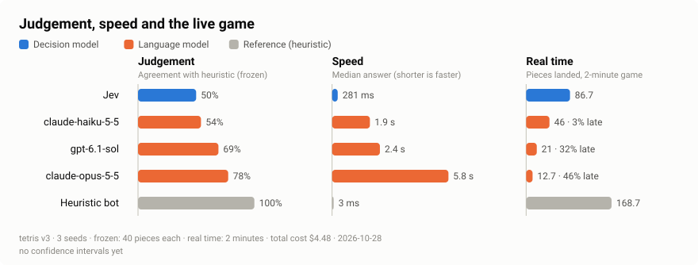

# decision-bench

[](https://github.com/jagadeeswara-reddy-p/jev-demos/actions/workflows/ci.yml)
[](LICENSE)

Benchmark models on judgement and speed, separately, by making them play real-time games. 2D reasoning (a board-only variant) is coming.

The first environment is *Deadline Tetris*, where pieces keep falling while the model thinks.

[](docs/media/demo-six-models.mp4)

*Seed 1, real-time clock, 6× speed. Click for the full recording.*

## Latest results

<picture>
  <source media="(prefers-color-scheme: dark)" srcset="docs/media/results-dark.svg">
  
</picture>

Deadline Tetris v3, 2026-10-28. Four models and the reference heuristic, 3 seeds on each clock: on the frozen clock every model places the same 40 pieces, so it measures judgement alone; in real time the pieces keep falling for 2 minutes while the model thinks. No confidence intervals yet.

| Model | Type | Agreement with heuristic (frozen) | Lines in 40 pieces (frozen) | Median answer | Pieces landed (real time) | Too late (real time) | Cost |
|---|---|---|---|---|---|---|---|
| Jev | decision model | 50% | 8.0 | 281 ms | 86.7 | 0% | $0.03 |
| Claude Haiku 5.5 | language model | 54% | 12.3 | 1.9 s | 46.0 | 3% | $0.07 |
| GPT-6.1 Sol | language model | 69% | 12.3 | 2.4 s | 21.0 | 32% | $0.95 |
| Claude Opus 5.5 | language model | 78% | 12.7 | 5.8 s | 12.7 | 46% | $3.44 |
| Heuristic (reference) | baseline | 100% | 14.7 | 3 ms | 168.7 | 0% | — |

Averages over the 3 seeds; median answer over every answer; cost for all six games ($4.48 in total).

**Agreement with heuristic** is the share of answers that picked the reference heuristic's top option ([how it works](docs/how-it-works.md#move-quality-best-moves)). The heuristic is a yardstick, not the truth.

The slower models choose better on the frozen clock, but in real time more of their answers arrive after the piece has landed, so they land fewer pieces.

The logs are in [benchmarks/2026-10-28](benchmarks/README.md); `bun bench chart benchmarks/2026-10-28/bench` redraws the chart and `bun run stats benchmarks/2026-10-28/bench/*.jsonl` prints every number. Earlier rounds are in the [results history](docs/results-history.md) and [findings](docs/findings.md).

## Quick start (no keys)

Needs [Bun](https://bun.sh) 1.4 or later.

```sh
git clone https://github.com/jagadeeswara-reddy-p/jev-demos && cd jev-demos
bun install
bun bench demo      # six mock models, no API calls; finishes in about a second
```

## Benchmark your models

```sh
bun bench init      # writes bench.yaml and .env from the examples
bun bench doctor    # checks each model and its key
bun bench run       # plays the bench and writes the logs
```

`bun bench chart runs/bench/<name>` draws the comparison chart.

Edit `bench.yaml` to choose models, seeds, clocks and stop rule. The example
uses mock models only; for a live model, put its key in `.env` ([keys](#keys-env)).
Both files are git-ignored. Reference: [docs/bench.md](docs/bench.md).

## What it measures

Run both clocks on the same seed.

| | Real time | Frozen |
|---|---|---|
| While a model thinks | pieces keep falling | the game waits |
| An answer counts if | it arrives before the piece locks | it arrives within 30 s |
| What it measures | is the model fast enough for a live loop? | does the model place pieces well? |

- In `bun bench`, a frozen match gives every board the same number of pieces (`tetris.frozenPieces`, 100 by default; a frozen `sprint40` uses `tetris.maxPieces`) and has no early stop. On the page, a frozen run still stops at the time limit.
- Every board gets the same pieces in the same order, the same prompt and the same rules. Real-time matches share one clock.
- **Coming:** a board-only variant, to test 2D reasoning on its own. See [how it works](docs/how-it-works.md).

## Watch it in the page

```sh
bun dev             # http://localhost:5317
```

Press **Models**, tick up to six models, press **Test** on any model for one real move, then **Start live run**. The **Line-up** menu has mock line-ups that need no keys. **Load log** replays a saved `.jsonl` run log.

### Keys (`.env`)

| Model | Set in `.env` |
|---|---|
| Jev | `TYPESAFE_API_KEY` |
| Cloudflare Clef | `CLOUDFLARE_ACCOUNT_ID`, `CLOUDFLARE_API_TOKEN` (Workers AI permission) |
| GPT-6.1 Sol, Claude Opus 5.5, Claude Haiku 5.5 (AWS Bedrock) | `AWS_ACCESS_KEY_ID`, `AWS_SECRET_ACCESS_KEY`, `AWS_SESSION_TOKEN` or `AWS_PROFILE`; `AWS_REGION` (default `us-east-1`) |
| Any OpenAI-compatible chat model | `LLM_BASE_URL`, `LLM_API_KEY`, `LLM_MODEL`, or add it in the Models panel |
| Laya, Strands Decider | `LAYA_BASE_URL`, `STRANDS_BASE_URL`; `deploy/ec2/launch.sh` sets them |

Restart `bun dev` after editing `.env`. Keys stay on the server; the page never receives them. The server listens on `127.0.0.1` unless `HOST` is set.

Page-added models are saved in `models.local.json` (git-ignored). Laya and Strands Decider run on a GPU that costs money while it is up; [docs/self-hosting.md](docs/self-hosting.md) covers it.

## Extend it

- **Add a model:** [docs/models.md](docs/models.md). **Write an adapter:** [docs/models.md](docs/models.md#writing-a-new-adapter).
- **Write an environment:** the contract is in `src/core/types.ts`; see [docs/design/eval-engine.md](docs/design/eval-engine.md#environment-plugin).
- **Developer notes:** [development](docs/development.md), [API](docs/api.md), [configuration](docs/configuration.md).

## Contributing, security, citation, license

- [CONTRIBUTING.md](CONTRIBUTING.md) lists the checks: `bun run lint && bun run typecheck && bun test`.
- [SECURITY.md](SECURITY.md) covers reporting and how keys are handled.
- [CITATION.cff](CITATION.cff) feeds GitHub's "Cite this repository" button.
- [MIT](LICENSE). Third-party models and the [JevBench](https://github.com/fstandhartinger/jevbench) data in `benchmarks/` keep their own terms.
