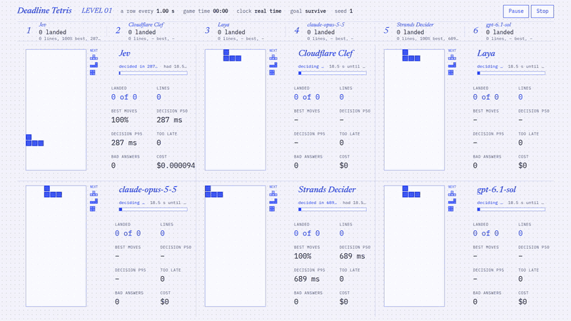
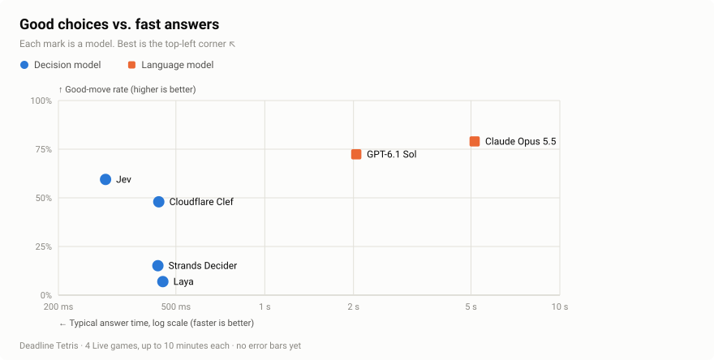
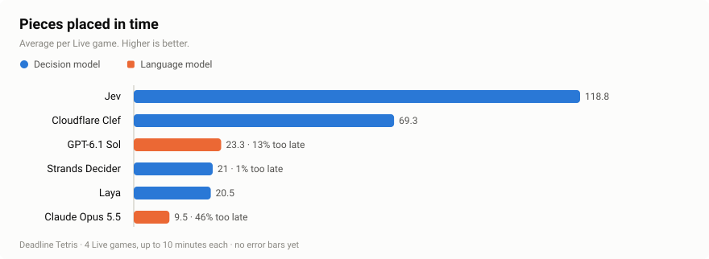

# decision-bench

[](https://github.com/jagadeeswara-reddy-p/jev-demos/actions/workflows/ci.yml)
[](LICENSE)

**Can a model make a good decision fast enough to act on it?**

In a live system, a late answer is as bad as a wrong one. decision-bench measures both: how well a model chooses, and whether its answer arrives in time.

The first test is **Deadline Tetris**, where each piece keeps falling while the model thinks.

[](docs/media/demo-six-models.mp4)

*Six models play the same pieces side by side, sped up 6×. Click for the video.*

## Results

<picture>
  <source media="(prefers-color-scheme: dark)" srcset="docs/media/results-choices-dark.svg">
  
</picture>

<picture>
  <source media="(prefers-color-scheme: dark)" srcset="docs/media/results-pieces-dark.svg">
  
</picture>

**Jev is the only model that is both fast and accurate, so it places the most pieces.** The language models choose well but answer too slowly. The small open decision models answer fast but choose poorly.

<details>
<summary>Full numbers and what they mean</summary>

| Model | Type | Good-move rate (higher is better) | Typical answer time (lower is better) | Pieces placed in time (higher is better) | Answers too late (lower is better) | Cost for 4 games |
|---|---|---|---|---|---|---|
| Jev | decision model | 59% | 289 ms | **118.8** | 0% | $0.03 |
| Cloudflare Clef | decision model | 48% | 438 ms | 69.3 | <1% | $0.11 |
| GPT-6.1 Sol | language model | 72% | 2.04 s | 23.3 | 13% | $0.48 |
| Strands Decider | decision model | 15% | 435 ms | 21.0 | 1% | self-hosted |
| Laya | decision model | 7% | 452 ms | 20.5 | 0% | self-hosted |
| Claude Opus 5.5 | language model | **79%** | 5.14 s | 9.5 | 46% | $1.02 |

- **Good-move rate:** how often the model picked the best spot, as scored by a standard Tetris evaluator. Late answers are graded too, so speed doesn't affect this number.[^grading]
- **Typical answer time:** the median time from showing the piece to getting the answer.
- **Pieces placed in time:** pieces that went where the model chose, because its answer arrived before the piece landed.
- **Answers too late:** the share of pieces that landed before the model answered.

Four Live games per model, averaged. Each game was stopped once four of the six boards had filled up.

</details>

[^grading]: The evaluator only looks at the current piece, so a model that plans ahead can lose a point for a better move. Read it as a yardstick, not the truth. [How answers are judged](docs/how-it-works.md#how-each-answer-is-judged).

Recompute everything from the raw logs in [benchmarks/](benchmarks/README.md):

```sh
bun bench chart benchmarks/2026-10-17/tetris --out docs/media/results
bun run stats benchmarks/2026-10-17/tetris/*.jsonl
```

Other rounds, including Claude Haiku 5.5, are in the [results history](docs/results-history.md). Why each model scores the way it does is in [findings](docs/findings.md).

## How the test works

1. A piece appears. The model gets the board and a numbered list of every place the piece can land.
2. The model answers with one option.
3. If the answer arrives before the piece lands, the piece goes there. If not, the piece lands wherever it falls.

In Live games the pieces fall faster every 15 seconds, so there is less and less time to answer.

| Mode | While the model thinks | What it shows |
|---|---|---|
| **Live** | the piece keeps falling | can the model choose well *and* in time? |
| **Paused** | the game waits (up to 30 s) | can the model choose well at all? |

Every model gets the same pieces, the same prompt and the same options. Rules and timings are in [how it works](docs/how-it-works.md).

## Try it

Needs [Bun](https://bun.sh) 1.4 or later. The demo uses mock models, so it needs no API keys:

```sh
git clone https://github.com/jagadeeswara-reddy-p/jev-demos && cd jev-demos
bun install
bun bench demo
```

To test your own models:

```sh
bun bench init      # creates bench.yaml and .env
bun bench doctor    # checks each model and its key
bun bench run       # plays the games
bun bench chart runs/bench/<name>    # draws the two charts next to the logs
```

Put your models in `bench.yaml` and their [keys](docs/configuration.md#built-in-models) in `.env`. To watch a game in the browser, run `bun dev` and open http://localhost:5317. Full reference: [docs/bench.md](docs/bench.md).

## Limitations

- **No error bars yet.** Four games is enough to rank these six models, but not to separate models that score close together.
- **Network time is included.** Every request came from one machine in India, which adds about 0.2–0.3 s.
- **One test so far.** More are on the [roadmap](#roadmap).

## Roadmap

- **2D reasoning:** a board-only Tetris variant, where the model gets only rotations and columns and has to picture the result.
- **Browser automation:** a second test, on the same engine.
- **More models and more games,** with error bars on every number.
- **Published results:** signed result bundles, and a results site with replays.

The design is in [docs/design/eval-engine.md](docs/design/eval-engine.md).

## Documentation

| Page | What's in it |
|---|---|
| [How it works](docs/how-it-works.md) | Rules, timings, the prompt, how answers are judged |
| [Findings](docs/findings.md) | Why each model scores the way it does |
| [Results history](docs/results-history.md) | Every round, including JevBench |
| [bun bench](docs/bench.md) | Every command and `bench.yaml` setting |
| [Models](docs/models.md) | Adding a model or writing an adapter |
| [Configuration](docs/configuration.md) | Keys, prices and server settings |
| [Self-hosting](docs/self-hosting.md) | Running Laya and Strands Decider on a GPU |
| [Development](docs/development.md) · [API](docs/api.md) | Code layout, tests and the server API |

## Contributing, security, citation, license

- [CONTRIBUTING.md](CONTRIBUTING.md) lists the checks: `bun run lint && bun run typecheck && bun test`.
- [SECURITY.md](SECURITY.md) covers reporting and how keys are handled.
- [CITATION.cff](CITATION.cff) feeds GitHub's "Cite this repository" button.
- [MIT](LICENSE). Third-party models and the [JevBench](https://github.com/fstandhartinger/jevbench) data in `benchmarks/` keep their own terms.
